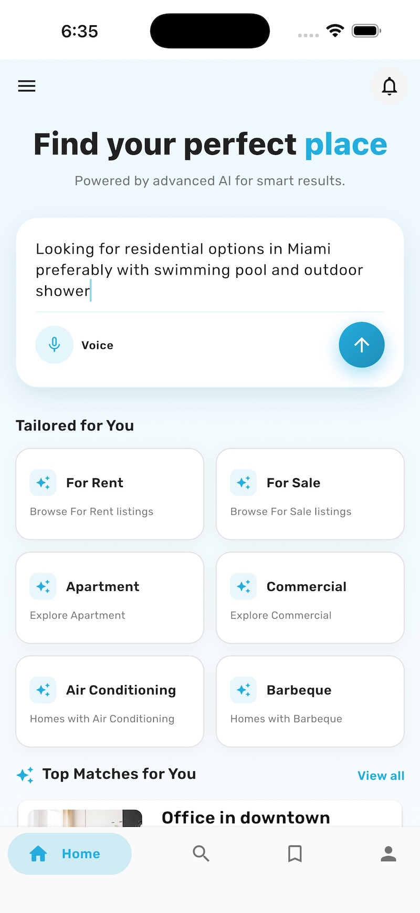

> **Requires:** Houzi app **1.4.8+** and Houzi Rest Api plugin **1.4.8+** with AI enabled. Follow the [AI Features setup guide](/tools/setup_ai_features) first to enable AI on your plugin.

Houzi 1.4.8 introduces **Home AI** — an AI-first home design — along with two AI-powered home widgets, **AI Smart Terms** and **AI Matches**, that you can add to *any* home design.



---

# Select the Home AI design

In Houzi Builder, go to the **Home** section and pick **Home AI** from the *Home Designs* on the top right — just like any other [home design](/houzi-builder/customize_home#home-designs). The *Mobile App View* in the center shows a live preview.

## The AI Header

The AI header is the fixed top area of the Home AI design. It contains:

- **Hero title** — a large greeting headline (e.g. *"Find your perfect place"*) with a subtitle.
- **AI search card** — a large, multiline natural language input where users type what they're looking for in plain words, with a **Voice** button for speaking the query instead. Submitting opens [AI Property Search](/tools/setup_ai_features).

The header is built into the design, so there's nothing to configure in the builder. The hero texts come from the app's localization files (`ai_*` keys in `assets/localization/*.json`), so you can reword them per language like any other string — see [Localization](/app-setup/localization).

Everything below the header is the regular config-driven `home_layout` pipeline — the same sections every other home design uses (`term_with_icons`, `property`, `recent_search`, and the new AI widgets below), in the order you arrange them in the builder.

---

# AI Widgets

Two new widget types are available when you [add a new section](/houzi-builder/customize_home#add-new-section) in the builder's Home section. They work in **any** home design — you don't have to use the Home AI design to use them (though Home AI ships with both by default).

Both widgets render their own headers and are fully self-contained: they fetch their own data, and if there's nothing to show they hide themselves — an empty section never appears on the home screen.

### ai_smart_terms — "Tailored for You"

A two-column grid of smart suggestion cards built from your website's **own taxonomies** — property status, property type, and property features. The cards are personalized: they are selected from the user's recent searches (most-searched terms first) and backfilled with your site's popular terms, so the grid is useful even for a brand-new user.

The short subtitle line under each card title is **AI-curated** (this is what the plugin's *Lite Model* is used for) so the wording resonates with the user's recent intent — city, size, budget. The cards render instantly with a generic subtitle and upgrade to the AI copy when it arrives; if AI is off or unreachable, the generic line simply stays. Tapping a card opens the matching property listing.

**Configurable fields:**

- **Title** — the section header. Leave empty to use the localized default *"Tailored for You"*.

### ai_matches — "Top Matches for You"

A property listing personalized from the user's own past searches. The widget mines the recent-searches history (captured by both the normal and AI search flows), builds one filter from the dominant signals — city, property type, bedrooms — and shows the matching properties, with a **View all** action. When the user has no search history yet, it falls back to your Featured listings, so the section is never empty.

**Configurable fields:**

- **Title** — the section header. Leave empty to use the localized default *"Top Matches for You"*.
- **Design** — the property item design used for the cards (same design options as the **property** widget type).
- **View Type** — **carousel** or **list**.

---

# Edit configurations.json directly

If you [edit your configuration file by hand](/houzi-builder/edit_configuration) instead of using the builder, the AI widgets are regular `home_layout` entries:

```json
{
  "section_type": "ai_smart_terms",
  "title": ""
},
{
  "section_type": "ai_matches",
  "title": "",
  "layout_design": "design_01",
  "section_listing_view": "list"
}
```

Leave `title` empty for the localized defaults. As always, increment `api_config_version` after changing the configuration.
