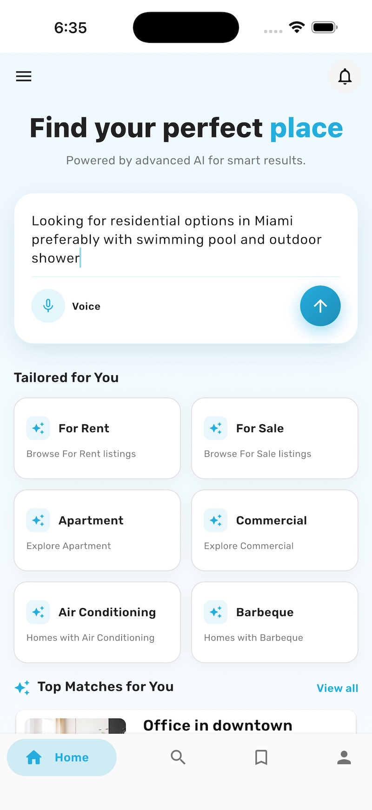
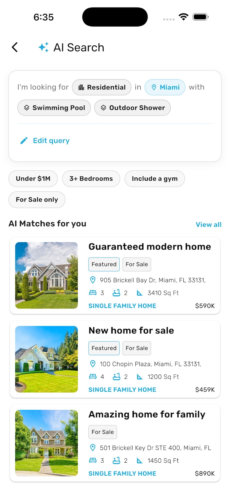
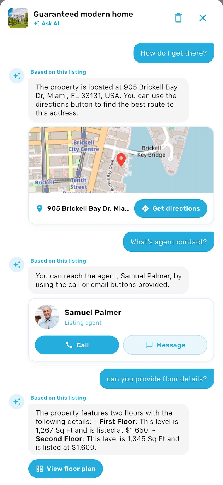
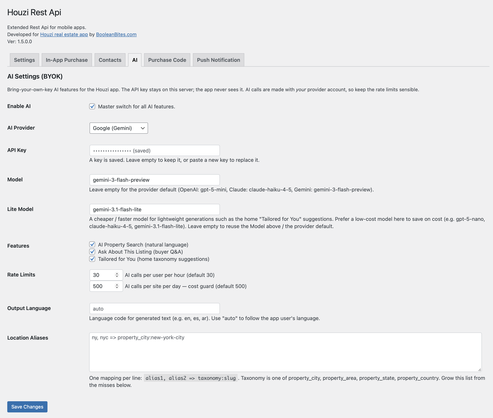

Houzi now ships with built-in AI features that make your real estate app smarter for your users. The AI features are powered by your own AI provider account (bring your own key), so you stay in full control of the provider, the model, and the cost.

There are three AI features in the app:

## 1. AI Home — Tailored for You

The home screen greets users with a natural language search box and a **Tailored for You** section — AI-generated shortcuts based on the taxonomies of your website (property types, statuses, and features), along with **Top Matches for You**.

## 2. AI Property Search

Users can type (or speak) what they're looking for in plain language — for example, *"Looking for residential options in Miami preferably with swimming pool and outdoor shower"*. The AI understands the query, converts it into structured search filters (property type, location, features), and shows matching listings. Users can refine further with suggested follow-up chips like *Under $1M* or *3+ Bedrooms*.

## 3. Ask About This Listing

On the property details screen, buyers can chat with AI about the listing. The AI answers questions strictly based on the listing data — directions to the property, agent contact, floor details, and more — with rich, actionable cards (map with directions, agent call/message buttons, floor plan).

 

# How to enable AI features

## 1. Upgrade

The AI features require:

- **Houzi Rest Api plugin** version **1.4.8** or above
- **Houzi app** version **1.4.8** or above

Update the [Houzi Rest Api plugin](/tools/houzi_plugin) on your WordPress site and rebuild your app with the latest Houzi version. If you're upgrading an existing project, follow the [1.4.8 Migration Guide](/tools/upgrading_future_version) first.

## 2. Enable AI on the plugin

In your WordPress admin, go to **Houzi Rest Api → AI** tab.

Turn on **Enable AI** — the master switch for all AI features.

## 3. Add your AI provider key

Houzi AI works on a **bring-your-own-key (BYOK)** model. Your API key stays on your server; the app never sees it. Pick one of the supported providers and paste its API key:

- **Google (Gemini)** — get a key from [Google AI Studio](https://aistudio.google.com/apikey)
- **Claude (Anthropic)** — get a key from the [Anthropic Console](https://console.anthropic.com/)
- **OpenAI** — get a key from the [OpenAI Platform](https://platform.openai.com/api-keys)

Select the provider in the **AI Provider** dropdown and paste the key in the **API Key** field.

## 4. Choose a model (we recommend flash / lite models)

Since AI calls are billed to your provider account, we **recommend using the flash / lite / mini model of each provider**. They are very cost effective and more than sufficient for the features Houzi offers:

| Provider | Recommended Model | Recommended Lite Model |
|----------|-------------------|------------------------|
| Google (Gemini) | `gemini-3-flash-preview` | `gemini-3.1-flash-lite` |
| Claude (Anthropic) | `claude-haiku-4-5` | `claude-haiku-4-5` |
| OpenAI | `gpt-5-mini` | `gpt-5-nano` |

> **Note:** These are the recommended models as of writing this doc (23 July 2026). Please check your provider's website for the latest available models when you set this up — newer flash / lite variants may have been released since.

- **Model** — used for the main features (AI Property Search, Ask About This Listing). Leave empty to use the provider default.
- **Lite Model** — a cheaper / faster model used for lightweight generations such as the home **Tailored for You** suggestions. Leave empty to reuse the Model above.

## 5. Pick the features you want

Under **Features**, toggle each AI feature individually:

- **AI Property Search** (natural language)
- **Ask About This Listing** (buyer Q&A)
- **Tailored for You** (home taxonomy suggestions)

## 6. Optional settings

- **Rate Limits** — protect your AI bill with per-user-per-hour and per-site-per-day caps (defaults: 30 and 500).
- **Output Language** — language code for generated text (e.g. `en`, `es`, `ar`). Use `auto` to follow the app user's language.
- **Location Aliases** — map the shorthand your users type to your actual location taxonomies, one mapping per line, e.g. `ny, nyc => property_city:new-york-city`. Grow this list from the misses the plugin reports below the field.

Hit **Save Changes** — and that's it. Launch the app and the AI features will light up on the home screen.
