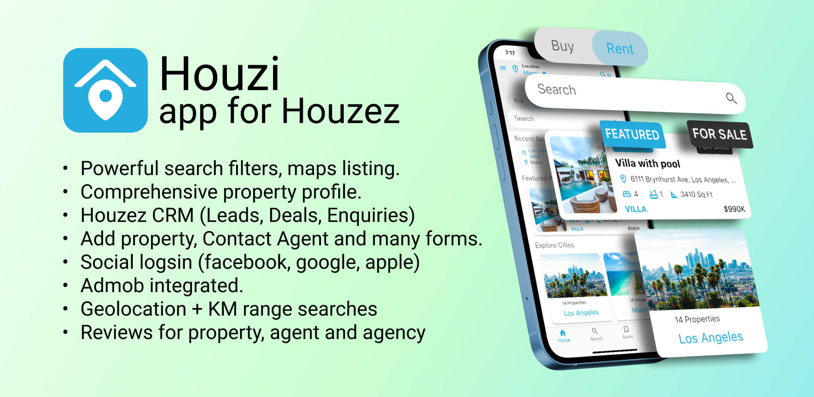
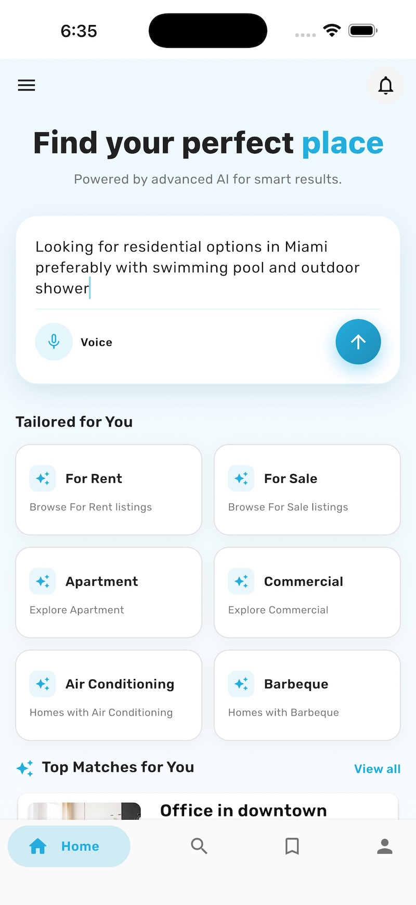
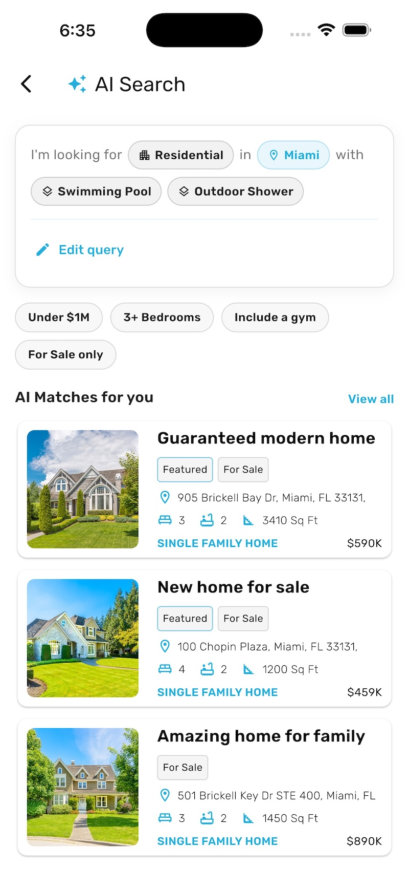
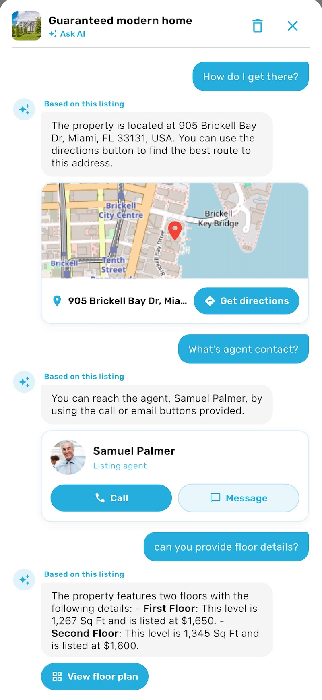

Houzi is a **real estate mobile app** for agents and agencies — now supercharged with **Houzi AI**. Built with Flutter, it ships to both Android and iOS from a single codebase and connects to your Houzez-powered website out of the box.

---

## 🤖 Meet Houzi AI

**New in [1.4.8](changelog)** — a suite of AI-powered experiences woven across the app, so home seekers can **search, discover, and ask in plain language**. It runs on a **bring-your-own-key** model, so *you* stay in full control of the provider, the model, and the cost. Works with **Google Gemini**, **Claude (Anthropic)**, and **OpenAI**.

<table width="100%" border="0" cellpadding="10">
<tr align="center" valign="top">
<td width="33%"></td>
<td width="33%"></td>
<td width="33%"></td>
</tr>
<tr align="center" valign="top">
<td><strong>Tailored for You</strong> An AI-first home that greets each user with a natural-language search box and personalized shortcuts built from <em>your own</em> property types, statuses, and features — plus a <em>Top Matches for You</em> row.</td>
<td><strong>AI Property Search + Voice</strong> Users type — or <em>speak</em> — what they want (<em>“residential in Miami with a pool”</em>). Houzi AI turns it into real filters and refines as you go with follow-up chips.</td>
<td><strong>Ask About This Listing</strong> Buyers chat with AI about any property. Answers stay grounded in that listing and come back as actionable cards — map directions, call the agent, floor details, and more.</td>
</tr>
</table>

**Bring Your Own Key (BYOK)** — your API key lives on *your* WordPress server; the app never sees it. Built-in per-user and per-site rate limits keep your AI bill in check.

[**Enable Houzi AI →**](tools/setup_ai_features) &nbsp;•&nbsp; [Design your AI home](houzi-builder/customize_home_ai) &nbsp;•&nbsp; [Read the 1.4.8 release notes](changelog)

---

> **Building with AI?** Houzi also includes a built-in **AI Agent Skill** that lets coding assistants like Antigravity, Cursor, Claude, or Copilot understand your app architecture and perform complex configurations automatically. [Learn how to use it](ai-agents/houzi_skill).

### Pathway

We've compiled a list of the most required things that you need to do in order to launch the app on device. We assume you have a website setup with Houzez. We also assume that you've purchased [Houzi app from CodeCanyon](https://codecanyon.net/item/houzi-real-estate-app/39753350).

1. [Setup Houzi plugin](tools/houzi_plugin)
2. [Setup App Secret](tools/app_secret)
3. [Setup JWT Auth plugin](tools/jwt_auth_plugin_setup)
4. [Install and setup Android Studio](tools/android_setup)
5. [Install and setup Flutter](tools/flutter_setup)
6. [Install and setup Xcode](tools/xcode_setup) (Optional)
7. [Tell your app about your website address](app-setup/change_app_url)
8. Launch on device

At this point, the app will still show Houzi branding, but it'll show your website data. Now to do the branding, you'll need to do following things:

1. Set [App Identifier](app-setup/change_app_identifier) AND [App name](app-setup/change_app_display_name) 
2. Set [App Icon](app-setup/change_app_icon) AND [Splash screen](app-setup/change_app_splash_screen)
3. [Create your own keystore](tools/setup_android_signing)
4. [Setup firebase](tools/firebase_setup)
5. [Setup GoogleCloud](tools/google_cloud_setup)
6. [Change App Theme](app-setup/change_app_theme)
7. Launch on device

At this point, the app will show your branding, with your data with firebase and google cloud project integrated. Go ahead and configure following things:

1. Configure Social Logins [Google](tools/setup_google_signin), [Facebook](tools/setup_facebook_signin), [Apple](tools/setup_apple_signin)
2. Configure [Phone Login](tools/setup_phone_signin)
3. Do any customization from [Houzi Builder](houzi-builder/intro) or [Hooks & Widgets](hooks-widgets/add_item_in_drawer).
4. Launch on device.

Houzi also supports push notifications. So if you want to configure push notification, follow this:
1. Configure [Push Notificatons](tools/push_notifications_integration)

Once you are ready:
1. Publish your app to [iOS AppStore](tools/publish_on_appstore)
2. Publish your app to [GooglePlay](tools/publish_on_google_play)

### Documentation

#### [Tools](tools/tools_setup)

This section addresses all the tools and other environment configurations you need to do get the development started.

#### [App Setup](app-setup/change_app_url)

This section guides through all the steps related to app setup and customization.

#### [Hooks & Widgets](hooks-widgets/add_item_in_drawer)

We have designed many hooks to provide way of customizing styles, designs and provide additional info to the app.

#### [Houzi Config Builder](houzi-builder/intro)

Houzi Builder is a desktop visual config builder. This section talks about designing and generating configuration with Houzi Builder, that can be used in the app.

#### [AI Agents](ai-agents/houzi_skill)

Learn how to leverage AI coding agents with the Houzi AI Skill to implement features and configurations quickly using natural language.

### Try the demo app here:

   

### Useful Links
[Houzi real estate app](https://houzi.booleanbites.com) | [BooleanBites Ltd](https://booleanbites.com)